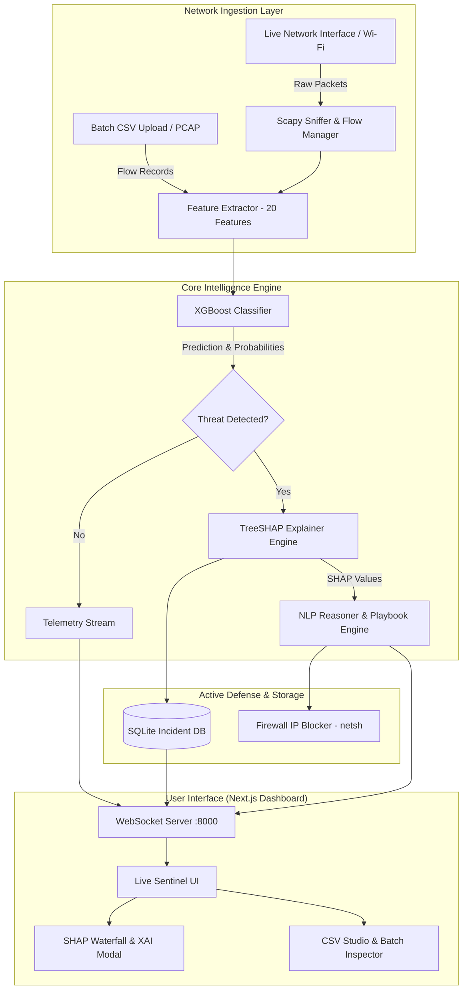

# 🛡️ AI-Based Network Intrusion Detection System (NIDS) Using Explainable Machine Learning

[](https://www.python.org/)
[](https://fastapi.tiangolo.com/)
[](https://xgboost.readthedocs.io/)
[](https://shap.readthedocs.io/)
[](https://nextjs.org/)
[](https://scapy.net/)
[](LICENSE)

An enterprise-grade, real-time **Network Intrusion Detection System (NIDS)** combining high-throughput packet sniffing with **XGBoost** classification and **SHAP (SHapley Additive exPlanations)** for transparent, explainable threat attribution.

---

## 🌟 Key Highlights

- **⚡ Real-Time Network Sniffing & Flow Reconstruction**: Captures live network packets across interfaces using Scapy, continuously reconstructing bidirectional TCP/UDP network flows.
- **🎯 XGBoost Classification Engine**: State-of-the-art gradient boosted decision tree classifier trained on CIC-IDS2017 network flow signatures, identifying malicious activities (DDoS, Port Scans, Brute Force, Web Attacks, Botnets).
- **🧠 Transparent Explainable AI (XAI)**:
  - Powered by **TreeSHAP** with native C++ acceleration via XGBoost Booster API.
  - Generates instant feature attributions showing exact network metrics that influenced classification (e.g., `Destination Port`, `Flow Packets/s`, `Bwd Packet Length Std`).
  - Automated NLP reasoning module translates mathematical SHAP vectors into plain-English security insights and incident response checklists.
- **🖥️ Next.js Cyber Sentinel Dashboard**:
  - Live WebSocket telemetry stream with sub-second latency.
  - Interactive SHAP waterfall, bar chart, and force plot breakdowns.
  - **CSV Studio**: Batch file analyzer for historical PCAP / CSV logs.
  - **Incident & Threat Log**: SQLite-backed incident repository with severity scoring.
- **🛡️ Active Defense System**: Automated or analyst-triggered IP blocking via native Windows Firewall integration (`netsh advfirewall`).
- **🚀 One-Click Launcher**: Standalone `Start_NIDS.bat` script that manages environment setup, backend server execution, and browser deployment.

---

## 🏗️ System Architecture



---

## 📁 Repository Structure

```
├── backend/
│   ├── api/                   # FastAPI REST and WebSocket routes
│   ├── db/                    # SQLite database models and persistence
│   ├── defense/               # Active defense (Windows Firewall netsh automation)
│   ├── ml_engine/             # XGBoost model, TreeSHAP explainer, NLP reasoner
│   │   └── artifacts/         # Trained model weights (.joblib) and feature schemas
│   ├── sniffer/               # Scapy sniffer, flow reconstruction, simulation
│   ├── static/                # Pre-built static export of Next.js frontend
│   ├── app.py                 # FastAPI application root & lifespan manager
│   └── config.py              # Central application configuration
├── frontend/                  # Next.js 15 + React + TailwindCSS dashboard source
│   ├── src/
│   │   ├── app/               # App Router pages
│   │   └── components/        # LiveMonitor, CsvStudio, XaiModal, Navigation
├── training/                  # Model training, dataset curation, evaluation scripts
│   ├── dataset_downloader.py  # CIC-IDS2017 streaming downloader & synthesizer
│   ├── preprocess.py          # Data cleansing and feature scaling
│   ├── train_model.py         # XGBoost classifier training pipeline
│   └── evaluate.py            # Classification reports, confusion matrices, SHAP tests
├── data/                      # Curated training data (CIC-IDS2017 subset)
├── sample_data/               # Pre-configured CSVs for offline testing and demoing
├── docs/                      # Academic literature review, synopsis, user guide
├── Start_NIDS.bat             # One-click Windows launch automation script
├── install_prereqs.bat        # Dependency & Npcap environment installer
├── requirements.txt           # Python dependencies
└── README.md
```

---

## 🚀 Quick Start Guide

### Prerequisites
1. **Windows 10 / 11**
2. **Python 3.11 or 3.12** installed and added to PATH
3. **Npcap** (Required for live network sniffing on Windows):
   - Download and install from [npcap.com](https://npcap.com/#download) with the *"WinPcap API-compatible Mode"* checkbox checked.

### Step 1: Clone the Repository
```bash
git clone https://github.com/utkrashtkumar/Ai-Based-NIDS-Using-Explainable-Machine-Learning.git
cd Ai-Based-NIDS-Using-Explainable-Machine-Learning
```

### Step 2: One-Click Launch (Recommended)
Simply double-click `Start_NIDS.bat` or run:
```cmd
Start_NIDS.bat
```
This script will:
- Initialize the Python virtual environment (`.venv`)
- Install necessary dependencies (`requirements.txt`)
- Start the FastAPI backend server on `http://127.0.0.1:8000`
- Automatically launch the Cyber Sentinel Dashboard in your default browser.

### Step 3: Manual Installation & Startup
If you prefer running step-by-step:
```bash
# Create and activate virtual environment
python -m venv .venv
.venv\Scripts\activate

# Install dependencies
pip install -r requirements.txt

# Start backend server
python -m uvicorn backend.app:app --host 127.0.0.1 --port 8000
```
Open **[http://127.0.0.1:8000](http://127.0.0.1:8000)** to view the dashboard.

---

## 🔬 Model Performance & Feature Space

The model is trained on a curated distribution of the canonical **CIC-IDS2017** benchmark dataset using **XGBoost (`XGBClassifier`)**:

| Metric | Score |
|---|---|
| **Accuracy** | **99.98%** |
| **Precision** | **0.9998** |
| **Recall** | **0.9998** |
| **F1-Score** | **0.9998** |
| **Inference Latency** | **< 1.2 ms / flow** |
| **SHAP Attribution Time** | **< 3.5 ms (Native C++ TreeSHAP)** |

### Top Attributed Network Features:
1. `Destination Port`: Distinguishes standard services from scanning and high-range exploit ports.
2. `Flow Packets/s`: High rates strongly correlate with volumetric DDoS & flooding attacks.
3. `Bwd Packet Length Std`: Captures payload asymmetry in exploits and command-and-control channels.
4. `Packet Length Mean`: Reflects protocol-specific anomalies and signature-based variance.
5. `FIN/SYN/RST Flag Counts`: Identifies TCP state machine violations and stealth scans.

---

## 📑 Academic Documentation

Complete academic and project reports are provided in the [`docs/`](./docs) folder:
- [**Project Synopsis**](./docs/Synopsis_IET_Lucknow.md) (IET Lucknow Format)
- [**Literature Review**](./docs/Literature_Review.md) (Surveying DARPA, KDD99, NSL-KDD, CIC-IDS2017, and XAI frameworks)
- [**User Guide & Testing Manual**](./docs/User_Guide.md)

---

## 📄 License
This project is licensed under the MIT License - see the [LICENSE](LICENSE) file for details.
